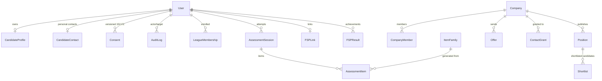
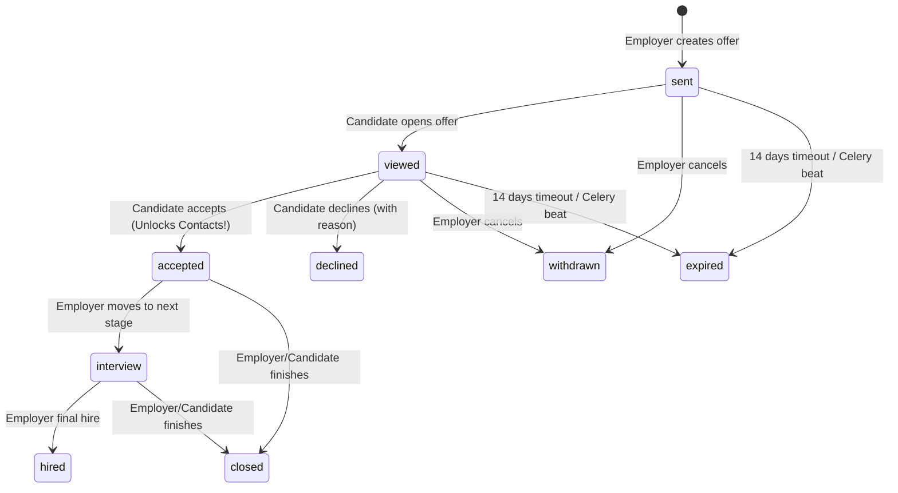
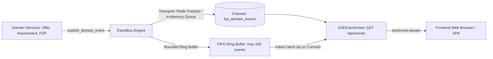

# FSP Draft — Backend Code & Architecture Documentation

Этот документ описывает внутреннее устройство серверной части платформы «FSP Draft», структуру модулей, сервисный слой, инварианты безопасности, шину доменных событий, интеграцию с Celery, OIDC IdP мок и границу сопряжения со слоем ML/AI.

---

## 1. Структура проекта и организация модулей

Проект реализован по паттерну **Modular Monolith** в каталоге `apps/`:

```text
apps/
├── core/                   # Общие интерфейсы (чистый листовой модуль без моделей домена)
│   ├── enums.py            # Все перечисления предметной области (UserRole, Grade, Specialization и др.)
│   ├── errors.py           # Иерархия FSPAPIError и кастомный exception handler DRF (RFC 7807)
│   ├── pagination.py       # Пагинация ответов в формате {items, total, page, pages}
│   └── management/
│       └── commands/seed.py # Идемпотентный сид стенда (мини-датасет, валидированный транзакцией)
│
├── identity/               # Управление пользователями, авторизация, OIDC и аудит
│   ├── models.py           # User, Identity, Consent (152-ФЗ), AuditLog
│   ├── oidc.py             # Authlib OIDC клиент: PKCE S256, login/link callback, jwt декодирование
│   ├── views.py            # Регистрация, сессионный логин, /me, demo persona, time-travel, CSRF
│   └── urls.py
│
├── profiles/               # Профили кандидатов, навыки, PDF-карточка игрока
│   ├── models.py           # CandidateProfile (public_id), CandidateContact, Skill, CandidateSkill
│   ├── selectors.py        # visible_candidates_for(company) — единый шлюз фильтрации видимости
│   ├── serializers.py      # Безопасные сериализаторы без утечки контактов
│   ├── pdf_service.py      # Генерация PDF «Карточка игрока» (WeasyPrint) с защитным QR-кодом
│   ├── views.py            # CRUD профиля, consents, resume parse, QR verify
│   └── urls.py
│
├── assessment/             # Адаптивное тестирование (CAT) и расчет рейтинга IRT
│   ├── models.py           # ItemFamily, AssessmentSession, AssessmentItem, LeagueMembership
│   ├── services.py         # AssessmentService: жизненный цикл, дедлайны, CatState, финализация
│   ├── engine.py           # ML-адаптер: ItemFamily, генераторы по seed, IRT EAP (ML-заглушка)
│   ├── serializers.py      # ItemViewSerializer (СТРОГО исключает key)
│   ├── views.py            # Проверка eligibility, сессия тестирования, прием ответов, fallback
│   └── urls.py
│
├── matching/               # Вакансии, скоринг кандидатов, шортлисты и полки лиг
│   ├── models.py           # Company, CompanyMember, Position, Shortlist
│   ├── selectors.py        # Оптимизированные выборки позиций и пулов
│   ├── scoring.py          # ML-адаптер: взвешенный расчет соответствия и ReasonChips (ML-заглушка)
│   ├── serializers.py      # Валидация зарплат (salary_min > 0, max >= min), TalentShortSerializer
│   ├── views.py            # Компании, CRUD вакансий, скоринг пула (/pool), полки лиг, шортлисты
│   └── urls.py
│
├── outreach/               # Драфт-офферы, машина состояний, события и раскрытие контактов
│   ├── models.py           # Offer, OfferEvent, ContactGrant, OFFER_TRANSITIONS
│   ├── services.py         # OfferService (optimistic locking), ContactAccessService (гейтинг контактов)
│   ├── events.py           # Шина доменных событий (Redis Pub/Sub + in-memory fallback, replay buffer)
│   ├── tasks.py            # Фоновые периодические задачи Celery (expire_offers)
│   ├── serializers.py      # Валидация офферов, защищенное раскрытие контактов при accepted
│   ├── views.py            # Создание офферов, view/accept/decline/withdraw, SSE-стриминг событий
│   └── urls.py
│
├── fsp_sync/               # Интеграция с Федерацией спортивного программирования
│   ├── models.py           # FSPLink, FSPResult
│   ├── services.py         # FSPService: привязка participant_id, пересчет strength без изменения grade
│   ├── registry.py         # Адаптер взаимодействия с реестром ФСП
│   ├── tasks.py            # Фоновая задача Celery (sync_all_fsp_profiles)
│   ├── views.py            # Привязка FSP ID, мок-реестр
│   └── urls.py
│
└── fsp_mock/               # Встроенный Keycloak-совместимый OIDC Identity Provider (DEMO_MODE)
    ├── keys.py             # Генерация и хранение RSA ключей (RS256 JWKS)
    ├── views.py            # OIDC Discovery, JWKS, Auth (PKCE), Token, UserInfo, Registry API
    └── urls.py
```

---

## 2. База данных и ограничения целостности (Data Integrity)

### Схема сущностей и связи



### Критические ограничения уровня БД (Constraints)

1. **`chk_position_salary_min_positive`** (`positions`):
   ```sql
   CHECK (salary_min > 0)
   ```
2. **`chk_position_salary_max_gte_min`** (`positions`):
   ```sql
   CHECK (salary_max >= salary_min)
   ```
3. **`chk_offer_salary_min_positive`** (`offers`):
   ```sql
   CHECK (salary_min > 0)
   ```
4. **`chk_offer_salary_max_gte_min`** (`offers`):
   ```sql
   CHECK (salary_max >= salary_min)
   ```
5. **`uq_candidate_skill_source`** (`candidate_skills`):
   Гарантирует уникальность навыка для конкретного источника подтверждения (`test`, `fsp`, `declared`).
6. **`uq_identity_provider_subject`** (`identities`):
   Гарантирует, что внешний идентификатор участника ФСП не может быть связан более чем с одним аккаунтом.

---

## 3. Сервисный слой и реализация инвариантов

### 3.1. Zero Contact Leaks: `ContactAccessService`

Контакты кандидата отделены от профиля. Модель `CandidateProfile` содержит только профессиональные характеристики и публичный идентификатор `public_id` (например, `C-7F3A2B`). Модуль `apps/core/` полностью декуплирован и является чистым листовым пакетом (leaf module).

Чтение контактов (`email`, `phone`, `telegram`) вынесено в защищенный доменный сервис:
```python
# apps/outreach/services.py
ContactInfo = ContactAccessService.get_contacts(
    company_id=company_id,
    candidate_id=candidate_id,
    actor_id=actor_id
)
```
**Логика проверки:**
1. Ищется активный (неотозванный) объект `ContactGrant` для пары `(company_id, candidate_id)`.
2. Если грант **отсутствует**:
   * Создается запись в `AuditLog` с `action='contact_access_denied'`.
   * Выбрасывается исключение `ContactNotGranted` (HTTP 403 RFC 7807).
3. Если грант **существует**:
   * Создается запись в `AuditLog` с `action='contact_access_granted'`.
   * Возвращается DTO `ContactInfo`.

### 3.2. Машина состояний оффера и оптимистичная блокировка

Драфт-офферы управляются классом `OfferService` (`apps/outreach/services.py`):



* **Оптимистичная блокировка (Optimistic Concurrency Control):**
  Каждый вызов `transition()` принимает `expected_version`. При обновлении в БД поле `version` инкрементируется на уровне СУБД через `F('version') + 1`. Если версия изменилась конкурентным запросом, выбрасывается `VersionConflict` (HTTP 409).
* **Сброс выражений ORM перед событиями:**
  Перед сериализацией объекта в событие или JSON вызывается `offer_locked.refresh_from_db()`, исключая ошибки несериализуемых `CombinedExpression`.
* **Автоматическое создание `ContactGrant`:**
  При переходе в `accepted` метод `transition()` атомарно создает `ContactGrant`, открывая работодателю легальный доступ к контактам, сохраняющийся на всех последующих этапах (`interview`, `hired`, `closed`).
* **Публикация доменных событий:**
  Каждый успешный переход публикует событие в шину: `offer.created`, `offer.updated`.

### 3.3. Шлюз видимости кандидатов: `CandidateVisibilitySelector`

Вся выборка кандидатов для работодателей (пулы, поиск, карточки талантов, создание офферов) централизована в `apps/profiles/selectors.py`:
`visible_candidates_for(company, qs=None) -> QuerySet[CandidateProfile]`

**Критерии фильтрации (Privacy & 152-ФЗ):**
1. **Согласие на публикацию:** последний по времени объект `Consent` типа `publication` имеет статус `granted=True`. При отзыве согласия кандидат немедленно исключается из всех выдач, а активные входящие офферы переводятся в статус `withdrawn`.
2. **Флаг активности:** `open_to_offers == True`.
3. **Подтверждение аккаунта:** адрес электронной почты верифицирован (`email_verified == True`).
4. **Статус в Лиге:** статус кандидата в `LeagueMembership` не является `pending`.
5. **Блок-листы компаний:** компания исключается, если ее `id` присутствует в `blocked_company_ids` кандидата.

### 3.4. Шина доменных событий и SSE-стриминг

Для обеспечения реактивного взаимодействия frontend и backend реализована шина доменных событий в `apps/outreach/events.py`:



* **События платформы:**
  * `offer.created` — создание нового драфт-оффера.
  * `offer.updated` — изменение статуса оффера (`viewed`, `accepted`, `declined`, `expired`, `interview`, `hired`, `closed`).
  * `league.updated` — обновление позиций и силы участников Лиги.
  * `fsp.synced` — завершение синхронизации достижений с реестром ФСП.
* **Транспорт событий:**
  * В рабочей среде используется **Redis Pub/Sub** (`settings.REDIS_URL`).
  * При локальной разработке или в тестах автоматически активируется **in-memory thread-safe queue**, гарантируя 100% работоспособность без внешних сервисов.
* **Кольцевой буфер и replay при подключении:**
  Шина хранит последние 100 событий (`_RECENT_EVENTS`). При открытии нового SSE-соединения клиенту передаются актуальные события, устраняя потерю сообщений при реконнекте или гонках сетевых запросов.

---

## 4. Оценивание (Assessment Engine) и Item Response Theory (IRT)

Оценивание кандидатов полностью детерминировано. В коде платформы полностью исключен вызов LLM для выставления грейдов или проверки ответов.

### 4.1. Архитектурная граница со слоем ML (ML Boundary & Stubs)

В соответствии с принципами разделения ответственности бэкенд и ML строго изолированы:
* **ML-сторона:** поставляет чистые алгоритмы и структуры данных в виде pure-Python модулей без зависимостей от Django ORM (`apps/assessment/engine.py`, генераторы семейств `ItemFamily`, модуль IRT EAP).
* **Бэкенд-сторона (`apps/assessment/services.py`):**
  * Управляет сессиями тестирования (`AssessmentSession`) и сериализацией состояния в поле `state` (`CatState`).
  * Контролирует дедлайны по времени: если ответ отправлен позже `deadline_at`, он принудительно засчитывается как неверный (`correct=False`).
  * Обеспечивает транзакционность через `transaction.atomic()` и `select_for_update()`.
  * Реализует эндпоинты завершения теста (`/finish`) и перехода на аварийный режим (`/fallback`).
  * Предоставляет стабильный адаптер-заглушку (stub) `CatEngine`, обеспечивающий идентичный интерфейс при замене на финальную ML-модель.

### 4.2. Параметрические семейства (`ItemFamily`)
Каждое задание порождается генератором, принимающим псевдослучайный `seed`:
```python
seed = sha256(f"{ITEM_SEED_SECRET}:{session_id}:{family_id}:{seq}")
instance = family.generate(seed)
```
* **Разделение данных:**
  * `instance.view`: содержит markdown формулировки, код и варианты ответа. Сохраняется в `AssessmentItem.view` и отдается клиенту.
  * `instance.key`: верный ответ, вычисленный детерминированным оракулом. Сохраняется в `AssessmentItem.key` и **никогда не сериализуется в API**.

### 4.3. IRT EAP Модель (3-Parameter Logistic Model)
Для каждого вопроса заданы параметры калибровки:
* $a$ — дискриминативность (способность различать сильных и слабых).
* $b$ — сложность вопроса.
* $c$ — вероятность угадывания.

По завершении теста вычисляются:
* $\theta$ (Theta) — латентный уровень способностей на IRT-шкале (обычно от $-3.0$ до $+3.0$).
* $SE$ — стандартная ошибка измерения.
* Спортивный рейтинг силы: $Rating = 1000 + 200 \times \theta$.

### 4.4. Принцип неизменяемости грейда (Grade Immutability)
* Грейд кандидата (`Junior`, `Middle`, `Senior`) устанавливается **только пороговыми значениями $\theta$ тестирования**.
* Достижения ФСП влияют **только на Profile Strength (ранжирование внутри Лиги)**:
  $$\text{Strength} = \min(100.0, \; \text{BaseStrength} + \text{FSP\_Boost})$$
* Сервис `recompute_strength(user)` атомарно пересчитывает силу, сохраняя исходный `base_strength` и рассчитывая `fsp_boost` заново, предотвращая накопление бонусов при повторных вызовах.
* Тест `test_fsp_achievements_boost_strength_not_grade` подтверждает, что даже звание Мастера спорта и победа в Чемпионате России не могут изменить подтвержденный грейд в обход тестирования.

---

## 5. Алгоритм скоринга вакансий и ReasonChips

Эндпоинт `GET /api/positions/{id}/pool` ранжирует кандидатов по 100-балльной шкале, формируя для каждого прозрачное объяснение.

### 5.1. Граница матчинга и скоринга (Matching Boundary & Stubs)
* **Бэкенд:** выполняет предварительную фильтрацию видимости через `visible_candidates_for(company)` и SQL-хард-фильтры (грейды, навыки, зарплаты), собирает данные кандидатов за 1 оптимизированный батч-запрос (`select_related`, `prefetch_related`) и преобразует их в легковесные DTO (`CandidateCtx`, `NeedCtx`).
* **ML-адаптер (`apps/matching/scoring.py`):** чистая функция `score_pool(need, pool, weights) -> list[Scored]`, изолированная от базы данных. До поставки продакшн-модели ML работает детерминированный адаптер-заглушка.

### 5.2. Формирование факторов скоринга:
1. **Совпадение стека (до 35 баллов):**
   * Обязательные навыки (`must_skills`) имеют вес 2.
   * Дополнительные (`nice_skills`) имеют вес 1.
   * Навыки со статусом `verified_by_test` получают максимальное доверие.
2. **Подтверждение грейда (до 25 баллов):**
   * Грейд подтвержден тестом в соответствующей Лиге: 25 баллов.
   * Грейд заявлен, но не подтвержден (`unconfirmed`): 15 баллов.
   * Несовпадение грейда: 5 баллов.
3. **Рейтинг IRT и сила профиля (до 15 баллов):**
   * Линейная функция от спортивного рейтинга ($1000 + 200\theta$).
4. **Спортивные достижения ФСП (до 15 баллов):**
   * Количество верифицированных соревнований в реестре + бонус за спортивный разряд (КМС/МС).
5. **Попадание в зарплатную вилку (до 10 баллов):**
   * Ожидания кандидата пересекаются с бюджетом вакансии.

Каждый фактор формирует чип обоснования `ReasonChips` с указанием источника:
* `source: "test"` — Проверено вступительным тестом платформы.
* `source: "fsp"` — Подтверждено реестром Федерации спортивного программирования.
* `source: "declared"` — Заявлено кандидатом самостоятельно.

---

## 6. Защищенный PDF «Карточка игрока» и онлайн-верификация

* Формируется сервисом `apps/profiles/pdf_service.py` на базе `WeasyPrint`.
* **Безопасность генерации:** используется кастомный безопасный URL fetcher (`data:` only), исключающий SSRF-атаки и чтение локальных файлов сервера; все строковые параметры экранируются.
* Включает стилизованную верстку с токенами бренда ФСП, текущую Лигу, подтвержденный грейд, рейтинг силы IRT и спортивный разряд.
* Содержит сгенерированный векторный QR-код, ведущий на публичный эндпоинт онлайн-проверки:
  `GET /api/verify/<public_id>`
* Эндпоинт проверки не требует авторизации и возвращает статус валидности карточки и подтвержденные достижения без раскрытия персональных данных.

---

## 7. Развертывание и выполнение фоновых задач (Celery)

### Конфигурация Celery
Конфигурация Celery определена в `config/celery.py` и инициализируется в `config/__init__.py`.

1. **Периодические задачи (Celery Beat):**
   * В `config/settings.py` настроен планировщик `CELERY_BEAT_SCHEDULE`:
     * `expire-stale-offers` (`apps.outreach.tasks.expire_offers`): выполняется каждые 5 минут, автоматически переводя просроченные офферы (`expires_at < now()`) в статус `expired` с публикацией доменного события `offer.updated`.
   * Для управления расписанием используется `django_celery_beat`, включенный в `INSTALLED_APPS`.
2. **Маршрутизация очередей (Task Routing):**
   * `CELERY_TASK_ROUTES` направляет задачи парсинга резюме/вакансий через AI/LLM (`llm_gateway.*`, `ai.*`) в выделенную очередь `llm`.
   * Воркер для очереди `llm` запускается с флагом `--concurrency=1`, предотвращая исчерпание лимитов внешних LLM API (GigaChat).
   * При сбоях или превышении 15-секундного таймаута AI-задачи откатываются к детерминированным правилам (rule-based fallback).

Команды запуска:
```bash
# Воркер основных очередей
celery -A config worker -l info -Q celery

# Воркер очередей LLM
celery -A config worker -l info -Q llm --concurrency=1

# Планировщик периодических задач
celery -A config beat -l info --scheduler django_celery_beat.schedulers:DatabaseScheduler
```

---

## 8. Мок-сервер авторизации ФСП (FSP Mock Identity Provider)

Для автономного тестирования и проведения демонстраций (Jury Mode) в каталог `apps/fsp_mock/` встроен полнофункциональный Keycloak-совместимый OIDC-сервер (активен в `DEMO_MODE`):

* **Эндпоинты OIDC (`/idp/`):**
  * `GET /idp/.well-known/openid-configuration` — OIDC Discovery документ.
  * `GET /idp/protocol/openid-connect/certs` — JWKS с публичным RSA-ключом (RS256).
  * `GET /idp/protocol/openid-connect/auth` — страница выбора тестового участника ФСП с генерацией authorization code и проверкой PKCE (S256).
  * `POST /idp/protocol/openid-connect/token` — выдача подписанного `id_token` и `access_token` с верификацией PKCE `code_verifier`.
  * `GET /idp/protocol/openid-connect/userinfo` — получение информации о профиле участника.
* **Реестр достижений:**
  * `GET /idp/registry/v1/participants/{id}/achievements` — защищенный сервисным токеном API реестра для импорта верифицированных соревнований и спортивных разрядов.
