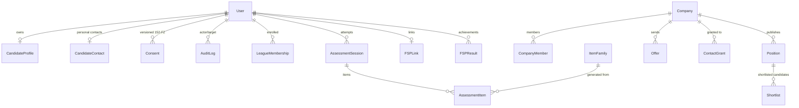
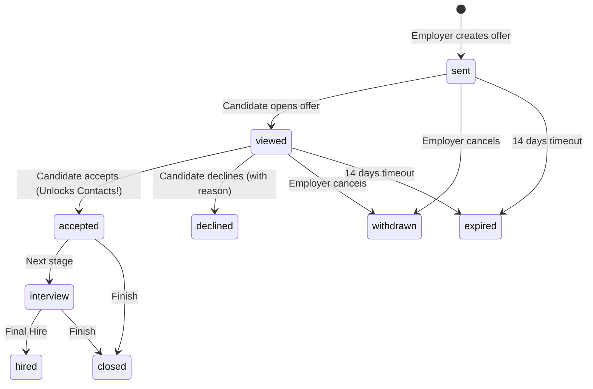

# FSP Draft — Backend Code & Architecture Documentation

Этот документ описывает внутреннее устройство серверной части платформы «FSP Draft», структуру модулей, сервисный слой, инварианты безопасности и математические модели оценивания и матчинга.

---

## 1. Структура проекта и организация модулей

Проект реализован по паттерну **Modular Monolith** в каталоге `apps/`:

```text
apps/
├── core/                   # Общие интерфейсы, сервис гейтинга контактов, ошибки RFC 7807, сиды
│   ├── enums.py            # Все перечисления предметной области (UserRole, Grade, Specialization и др.)
│   ├── errors.py           # Иерархия FSPAPIError и кастомный exception handler DRF
│   ├── services.py         # ContactAccessService — единственный шлюз к чтению контактов
│   ├── pagination.py       # Пагинация ответов в формате {items, total, page, pages}
│   └── management/
│       └── commands/seed.py # Идемпотентный сид стенда (мини-датасет)
│
├── identity/               # Управление пользователями, авторизация и аудит
│   ├── models.py           # User, Identity, Consent (152-ФЗ), AuditLog
│   ├── views.py            # Регистрация, сессионный логин, /me, demo persona, time-travel
│   └── urls.py
│
├── profiles/               # Профили кандидатов, навыки, PDF-карточка игрока
│   ├── models.py           # CandidateProfile (public_id), CandidateContact, Skill, CandidateSkill
│   ├── serializers.py      # Безопасные сериализаторы без утечки контактов
│   ├── pdf_service.py      # Генерация PDF «Карточка игрока» (WeasyPrint) с защитным QR-кодом
│   ├── views.py            # CRUD профиля, consents, resume parse, QR verify
│   └── urls.py
│
├── assessment/             # Адаптивное тестирование (CAT) и расчет рейтинга IRT
│   ├── models.py           # ItemFamily, AssessmentSession, AssessmentItem, LeagueMembership
│   ├── engine.py           # Базовый класс ItemFamily, параметрические генераторы, IRT EAP
│   ├── serializers.py      # ItemViewSerializer (СТРОГО исключает key)
│   ├── views.py            # Проверка eligibility, сессия тестирования, прием ответов, финализация
│   └── urls.py
│
├── matching/               # Вакансии, скоринг кандидатов и шортлисты
│   ├── models.py           # Company, CompanyMember, Position, Shortlist
│   ├── scoring.py          # Взвешенный расчет соответствия и ReasonChips
│   ├── serializers.py      # Валидация зарплат (salary_min > 0, max >= min), TalentShortSerializer
│   ├── views.py            # Компании, CRUD вакансий, скоринг пула (/pool), шортлисты
│   └── urls.py
│
├── outreach/               # Драфт-офферы, машина состояний и раскрытие контактов
│   ├── models.py           # Offer, OfferEvent, ContactGrant, OFFER_TRANSITIONS
│   ├── services.py         # OfferService (транзакции, optimistic locking, авто-грант)
│   ├── serializers.py      # Валидация офферов, защищенное раскрытие контактов при accepted
│   ├── views.py            # Создание офферов, view/accept/decline/withdraw, SSE-стриминг
│   └── urls.py
│
└── fsp_sync/               # Интеграция с Федерацией спортивного программирования
    ├── models.py           # FSPLink, FSPResult
    ├── tasks.py            # Фоновая задача Celery (sync_all_fsp_profiles)
    ├── views.py            # Привязка FSP ID, мок-реестр, пересчет strength без изменения grade
    └── urls.py
```

---

## 2. База данных и ограничения целостности (Data Integrity)

### Схема сущностей и связи



### Критические ограничения уровня БД (Constraints)

1. **`chk_position_salary_min_positive`** (`positions`):
   ```sql
   CHECK (salary_min > 0)
   ```
2. **`chk_position_salary_max_gte_min`** (`positions`):
   ```sql
   CHECK (salary_max >= salary_min)
   ```
3. **`chk_offer_salary_min_positive`** (`offers`):
   ```sql
   CHECK (salary_min > 0)
   ```
4. **`chk_offer_salary_max_gte_min`** (`offers`):
   ```sql
   CHECK (salary_max >= salary_min)
   ```
5. **`uq_candidate_skill_source`** (`candidate_skills`):
   Гарантирует уникальность навыка для конкретного источника подтверждения (`test`, `fsp`, `declared`).
6. **`uq_identity_provider_subject`** (`identities`):
   Гарантирует, что внешний идентификатор участника ФСП не может быть связан более чем с одним аккаунтом.

---

## 3. Сервисный слой и реализация инвариантов

### 3.1. Zero Contact Leaks: `ContactAccessService`

Контакты кандидата отделены от профиля. Модель `CandidateProfile` содержит только профессиональные характеристики и публичный идентификатор `public_id` (например, `C-7F3A2B`).

Чтение контактов (`email`, `phone`, `telegram`) реализовано исключительно через:
```python
# apps/core/services.py
ContactInfo = ContactAccessService.get_contacts(
    company_id=company_id,
    candidate_id=candidate_id,
    actor_id=actor_id
)
```
**Логика проверки:**
1. Ищется активный (неотозванный) объект `ContactGrant` для пары `(company_id, candidate_id)`.
2. Если грант **отсутствует**:
   * Создается запись в `AuditLog` с `action='contact_access_denied'`.
   * Выбрасывается исключение `ContactNotGranted` (HTTP 403 RFC 7807).
3. Если грант **существует**:
   * Создается запись в `AuditLog` с `action='contact_access_granted'`.
   * Возвращается DTO `ContactInfo`.

### 3.2. Машина состояний оффера и оптимистичная блокировка

Драфт-офферы управляются классом `OfferService`:



* **Оптимистичная блокировка (Optimistic Concurrency Control):**
  Каждый вызов `transition()` принимает `expected_version`. При обновлении в БД поле `version` увеличивается на 1 через `F('version') + 1`. Если версия изменилась конкурентным запросом, выбрасывается `VersionConflict` (HTTP 409).
* **Автоматическое создание `ContactGrant`:**
  При переходе в `accepted` метод `transition()` вызывает `ContactAccessService.create_grant()`, открывая работодателю легальный доступ к контактам.

---

## 4. Оценивание (Assessment Engine) и Item Response Theory (IRT)

Оценивание кандидатов полностью детерминировано. В коде отсутствует вызов LLM для выставления грейдов или проверки ответов.

### 4.1. Параметрические семейства (`ItemFamily`)
Каждое задание порождается генератором, принимающим псевдослучайный `seed`:
```python
seed = sha256(f"{ITEM_SEED_SECRET}:{session_id}:{family_id}:{seq}")
instance = family.generate(seed)
```
* **Разделение данных:**
  * `instance.view`: содержит markdown формулировки, код и варианты ответа. Сохраняется в `AssessmentItem.view` и отдается клиенту.
  * `instance.key`: верный ответ, вычисленный детерминированным оракулом. Сохраняется в `AssessmentItem.key` и **никогда не сериализуется в API**.

### 4.2. IRT EAP Модель (3-Parameter Logistic Model)
Для каждого вопроса заданы параметры калибровки:
* $a$ — дискриминативность (способность различать сильных и слабых).
* $b$ — сложность вопроса.
* $c$ — вероятность угадывания.

По завершении теста вычисляются:
* $\theta$ (Theta) — латентный уровень способностей на IRT-шкале (обычно от $-3.0$ до $+3.0$).
* $SE$ — стандартная ошибка измерения.
* Спортивный рейтинг силы: $Rating = 1000 + 200 \times \theta$.

### 4.3. Принцип неизменяемости грейда (Grade Immutability)
* Грейд кандидата (`Junior`, `Middle`, `Senior`) устанавливается **только пороговыми значениями $\theta$ тестирования**.
* Достижения ФСП влияют **только на Profile Strength (ранжирование внутри Лиги)**:
  $$\text{Strength} = \min(100.0, \; \text{BaseStrength} + \text{FSP\_Boost})$$
* Тест `test_fsp_achievements_boost_strength_not_grade` подтверждает, что даже звание Мастера спорта и победа в Чемпионате России не могут изменить подтвержденный грейд в обход тестирования.

---

## 5. Алгоритм скоринга вакансий и ReasonChips

Эндпоинт `GET /api/positions/{id}/pool` ранжирует кандидатов по 100-балльной шкале, формируя для каждого прозрачное объяснение:

1. **Совпадение стека (до 35 баллов):**
   * Обязательные навыки (`must_skills`) имеют вес 2.
   * Дополнительные (`nice_skills`) имеют вес 1.
   * Навыки со статусом `verified_by_test` получают максимальное доверие.
2. **Подтверждение грейда (до 25 баллов):**
   * Грейд подтвержден тестом в соответствующей Лиге: 25 баллов.
   * Грейд заявлен, но не подтвержден (`unconfirmed`): 15 баллов.
   * Несовпадение грейда: 5 баллов.
3. **Рейтинг IRT и сила профиля (до 15 баллов):**
   * Линейная функция от спортивного рейтинга ($1000 + 200\theta$).
4. **Спортивные достижения ФСП (до 15 баллов):**
   * Количество верифицированных соревнований в реестре + бонус за спортивный разряд (КМС/МС).
5. **Попадание в зарплатную вилку (до 10 баллов):**
   * Ожидания кандидата пересекаются с бюджетом вакансии.

Каждый фактор формирует чип обоснования `ReasonChips` с указанием источника:
* `source: "test"` — Проверено вступительным тестом платформы.
* `source: "fsp"` — Подтверждено реестром Федерации спортивного программирования.
* `source: "declared"` — Заявлено кандидатом самостоятельно.

---

## 6. Защищенный PDF «Карточка игрока» и онлайн-верификация

* Формируется сервисом [`apps/profiles/pdf_service.py`](file:///c:/Users/bikhe/projects/IITT-fsp-lct/apps/profiles/pdf_service.py) на базе `WeasyPrint`.
* Включает стилизованную верстку с токенами бренда ФСП, текущую Лигу, подтвержденный грейд, рейтинг силы IRT и спортивный разряд.
* Содержит сгенерированный векторный QR-код, ведущий на публичный эндпоинт онлайн-проверки:
  `GET /api/verify/<public_id>`
* Эндпоинт проверки не требует авторизации и возвращает статус валидности карточки и подтвержденные достижения без раскрытия персональных данных.

---

## 7. Развертывание и выполнение фоновых задач (Celery)

### Очередь задач Celery
Конфигурация Celery определена в [`config/celery.py`](file:///c:/Users/bikhe/projects/IITT-fsp-lct/config/celery.py).
Для запуска воркера Celery в рабочей среде:
```bash
celery -A config worker --loglevel=info
```
Для запуска планировщика синхронизации:
```bash
celery -A config beat --loglevel=info
```
Периодическая задача `sync_all_fsp_profiles` опрашивает реестр ФСП, обновляет таблицу `fsp_results` с вычислением хэшей целостности `source_hash` и пересчитывает перцентили в Лигах.
